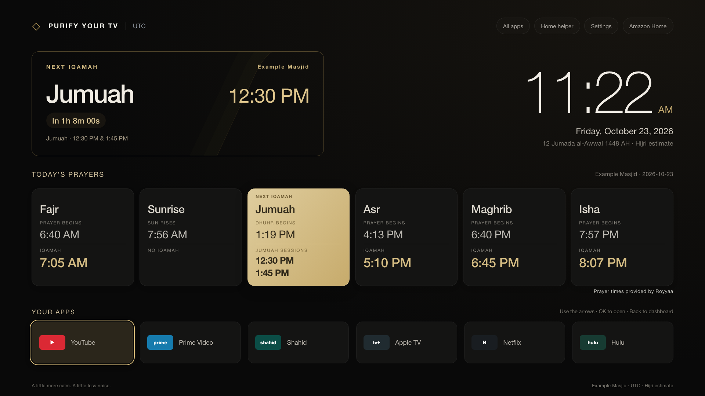
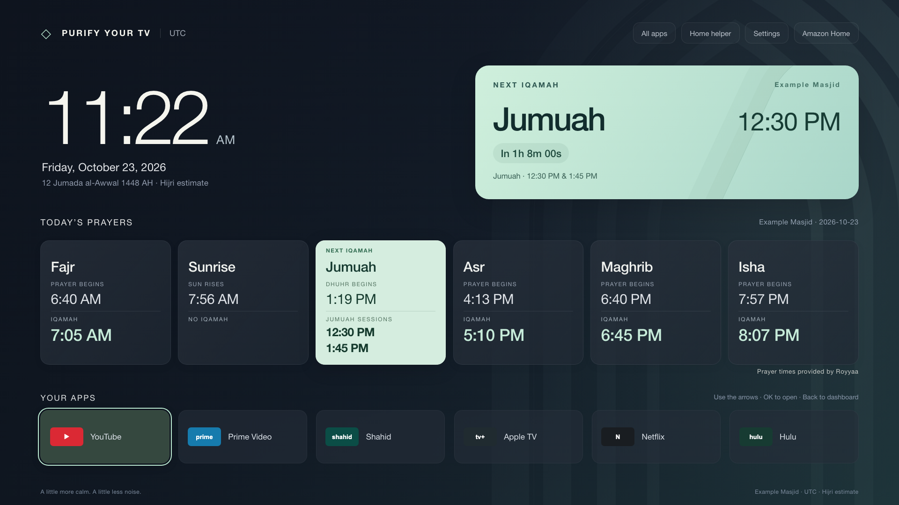
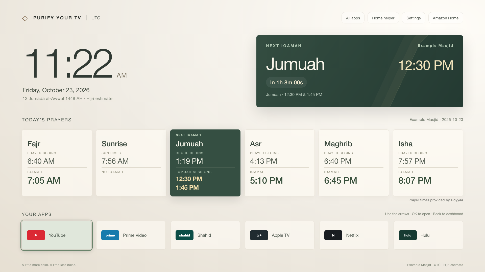
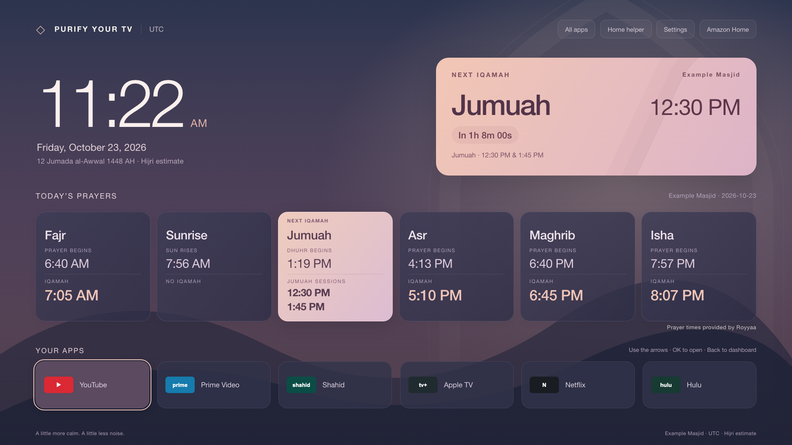
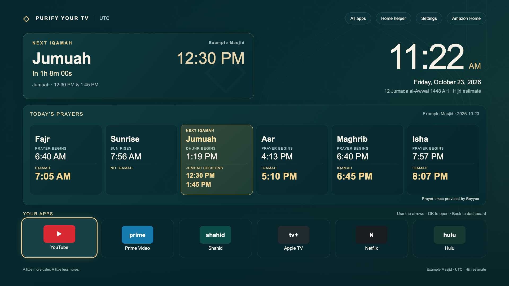
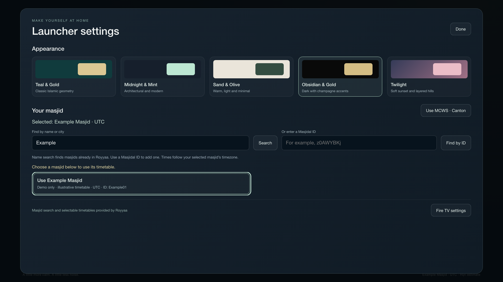

# Screenshots

These are 1920×1080 **browser-rendered UI demonstrations** of the checked-in app assets. They use a fictional Example Masjid, illustrative prayer times, placeholder app icons and no personal device identifiers. They are not live timetables or proof of on-TV Home behavior. The device record separately describes real TV verification.

## Obsidian & Gold

## Midnight & Mint

## Sand & Olive

## Twilight

## Teal & Gold

## Launcher settings

Actual screenshots can be taken locally with `python3 tools/tv.py --device <TV_IP>:5555 screenshot shots/dashboard.png`. Never commit an unreviewed screenshot containing accounts, network details, personal names, locations or device identifiers.
